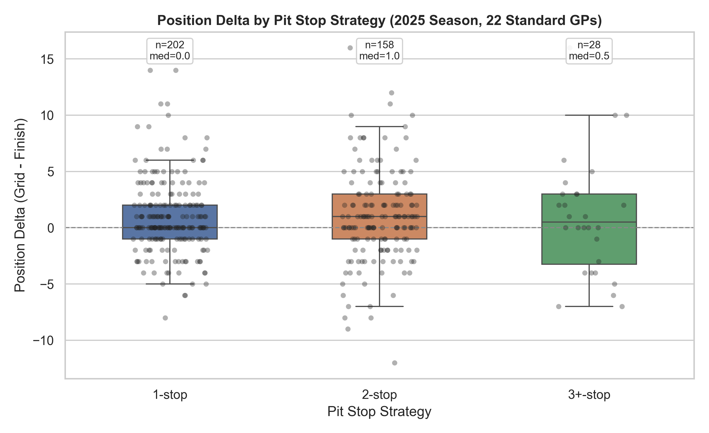

# F1 Pit Stop Strategy Analysis (2025 Season)

Statistical and econometric analysis of Formula 1 pit stop strategies and their impact on race outcomes across all 24 Grands Prix of the 2025 FIA Formula One World Championship.

**[Live Interactive Telemetry Dashboard](https://f1-strategy-telemetry.streamlit.app)**

## Research Question
How do pit stop frequency and relative pit-window timing affect driver grid-to-finish position delta (`grid_position - finish_position`), and how much of that effect remains after controlling for starting grid position, constructor pace, circuit characteristics, and Safety Car interventions?

## Dataset & Pipeline Architecture
- **Data Ingestion (`src/ingest.py`):** Automated retrieval of race classifications, lap data, pit stop events, tire compounds, and track status flags across all 24 main races of the 2025 season via the **FastF1** API (479 driver-race entries; Sprint sessions excluded).
- **Data Cleaning (`src/clean.py`):** Explicit flagging and filtering of non-finishing edge cases (51 DNFs, 6 disqualifications, 3 DNS), retaining **419 finished/lapped entries** for strategy evaluation.
- **Feature Engineering (`src/features.py`):** Computation of `position_delta`, strategy groups (`1-stop`, `2-stop`, `3+-stop`), race-relative stop deviations (`stops_vs_race_median`), normalized and relative first pit stop timing (`first_pit_vs_race_median`, undercut/standard/overcut windows), circuit technical classifications, and flagging of extreme multi-stop wet/disrupted races (Australia and Canada, median $\ge 4$ stops).
- **Statistical Modeling (`src/analysis.py`):** Non-parametric hypothesis tests (`scipy`) and heteroscedasticity-robust OLS regression (`statsmodels`, HC3 covariance) on the **22 standard Grands Prix ($N = 388$)**.
- **Visualization (`src/visualize.py`):** High-resolution diagnostic and regression plots saved to `plots/`.

## Key Findings (2025 Standard GPs, $N = 388$)
1. **Unadjusted Strategy Averages Are Misleading:** Without controls, `1-stop` ($n = 202$, mean $+0.96$, median $0.0$), `2-stop` ($n = 158$, mean $+0.95$, median $+1.0$), and `3+-stop` ($n = 28$, mean $+0.96$, median $+0.5$) show virtually identical raw position deltas (Kruskal-Wallis $H = 0.082, p = 0.960$).
2. **Pit-Window Timing Shows Situational Spread:** Drivers pitting late relative to the race median (`>= +3 laps`, overcut/long-stint profile, $n = 114$) averaged $+1.55$ positions compared to $+0.43$ for standard-window stoppers ($n = 169$) and $+1.16$ for early stoppers ($n = 105$; Kruskal-Wallis $H = 4.746, p = 0.093$; Spearman $\rho = 0.041, p = 0.426$).
3. **Controlling for Grid & Constructor Pace Isolates Strategy Cost:** In the multivariable OLS regression ($R^2 = 0.426$, Adj. $R^2 = 0.403$, HC3 robust SEs):
   - **Extra Stops vs. Race Median (`stops_vs_race_median`):** $\beta = -1.915$ ($p < 0.001$, 95% CI $[-2.837, -0.993]$). Making one additional stop beyond the race's standard strategy costs nearly **2 finishing positions** on average (reflecting reactive recoveries, punctures, or unrewarded extra stops).
   - **Starting Grid Regression-to-the-Mean (`grid_position`):** $\beta = +0.513$ ($p < 0.001$), capturing the structural asymmetry in overtaking room from back vs. front grid slots.
   - **Constructor Pace (`C(team)`):** Explains a substantial share of position gains at equal grid positions.

## Visual Summary

### 1. Position Delta by Pit Stop Strategy

### 2. Position Delta by Relative First Pit Stop Window

### 3. Multivariable OLS Regression Drivers (95% HC3 Confidence Intervals)

## Repository Structure
- `src/` — Modular pipeline (`ingest.py`, `clean.py`, `features.py`, `analysis.py`, `visualize.py`)
- `data/raw/` — Raw 2025 race dataset retrieved via FastF1 API (`f1_2025_races_raw.csv`)
- `data/processed/` — Cleaned (`f1_2025_races_clean.csv`) and feature-engineered (`f1_2025_races_features.csv`) datasets
- `outputs/tables/` — Exported statistical test results, group summaries, and regression coefficients
- `plots/` — Publication-ready figures referenced in documentation
- `notebooks/` — Exploratory diagnostics and supplementary analysis
- `archive/` — Initial 4-race manual prototype kept for historical reference

## Setup & Usage
1. Create and activate a virtual environment:

    python -m venv .venv
    source .venv/bin/activate  # On Windows: .venv\Scripts\activate

2. Install dependencies:

    python -m pip install -r requirements.txt

3. Run the full reproducible pipeline:

    python src/ingest.py
    python src/clean.py
    python src/features.py
    python src/analysis.py
    python src/visualize.py

*(Note: `src/ingest.py` caches FastF1 session data locally under `data/raw/.fastf1_cache/` and requires a free Formula 1 account login on initial fetch).*

## Roadmap
- [x] Automated data collection across all 24 GPs of the 2025 season via FastF1 API
- [x] Edge-case handling (DNF, DNS, DSQ) and data cleaning pipeline
- [x] Feature engineering (relative pit timing, race-median deviations, circuit profiles)
- [x] Non-parametric hypothesis tests (`scipy`) and HC3-robust regression (`statsmodels`)
- [x] Automated diagnostic visualization suite (`plots/`)
- [x] Interactive web dashboard (`app/streamlit_app.py`)

## Contact
**Filippo Castagnola** — fi.castagnola@gmail.com
